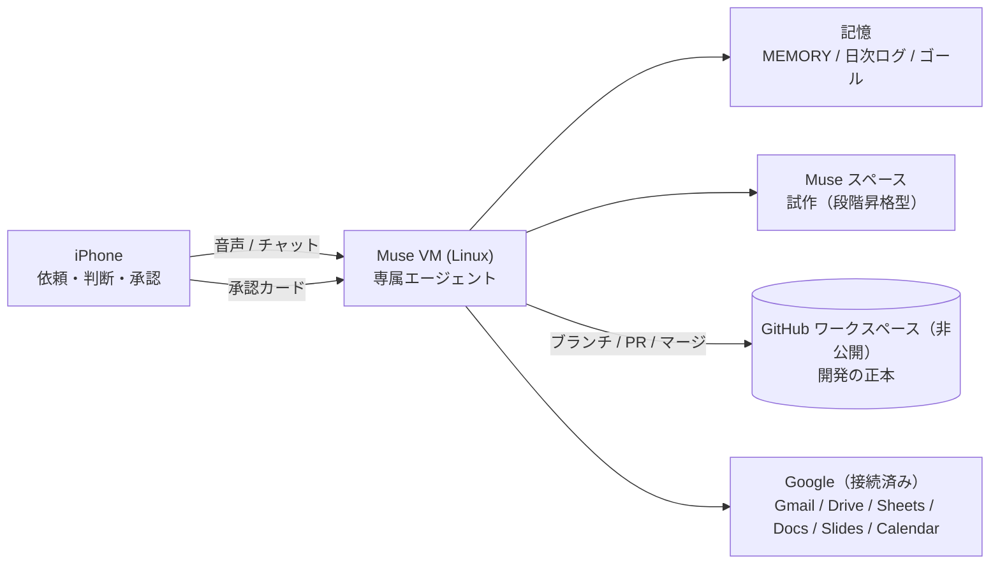

# ai-dev-public

iPhone から AIエージェント (Muse) に指示して進める **AI駆動開発の仕組みと成果物の公開ページ** です。

開発の正本は非公開のワークスペースにあり、ここには公開してよいものだけを点検のうえコピーして置いています（履歴はこのリポジトリで新しく始まります）。開発はここでは行いません。

ホームページ版: `docs/index.html`（GitHub Pages で公開できます）

## アーキテクチャ概要

## ドキュメント

- [docs/architecture.md](docs/architecture.md) — 現在の仕組みのアーキテクチャ図と状態表
- [docs/setup.md](docs/setup.md) — セットアップの流れ（実施済み手順の記録）
- [docs/playbook.md](docs/playbook.md) — ハイブリッド開発（段階昇格型）の運用プレイブック
- [docs/index.html](docs/index.html) — ホームページ（GitHub Pages 用）

## 公開ポリシー

- 公開前に、秘密情報・個人情報が含まれていないかを点検する
- 正本（非公開）→ 公開側 の一方向コピーのみ。公開側で直接編集しない
- 秘密情報（パスワード、APIキー、トークン）は、正本・公開側のどちらにもコミットしない

## 状態

- 2026-11-08: 公開リポジトリを作成し、アーキテクチャ図・セットアップ手順・プレイブック・ホームページを初回コピー
