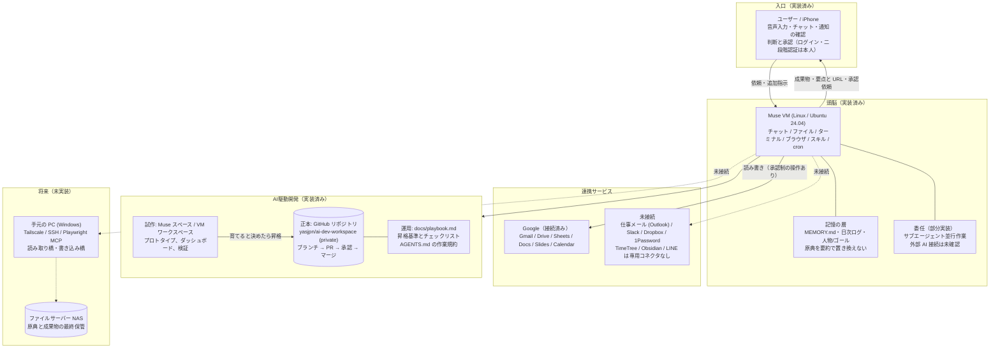
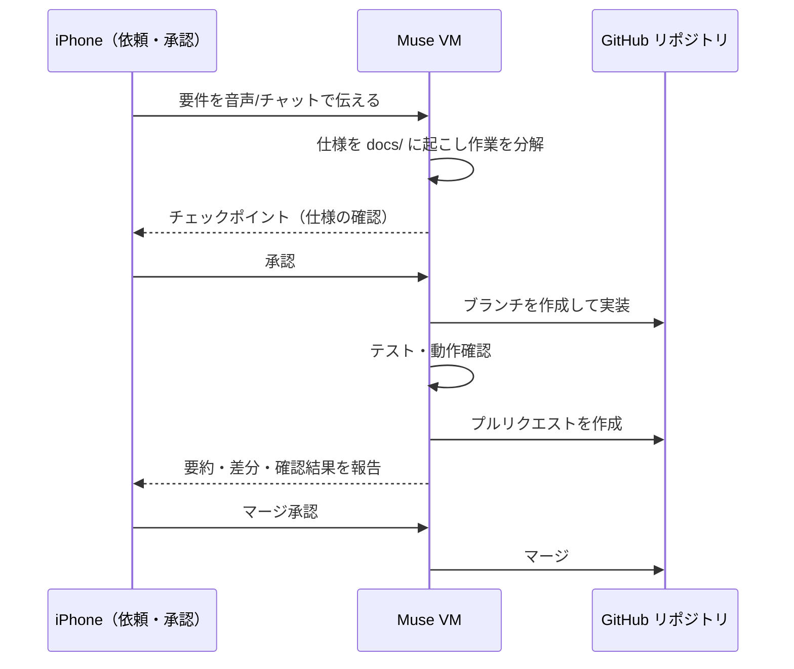

# アーキテクチャ図 — 現在の仕組み

2026-11-08 時点の実装状態を反映した構成図です。
方針は「案4: ハイブリッド型（段階昇格型）」。試作は軽い場所で速く、本格開発はこのリポジトリを正本に行います。

## 全体図

## 開発サイクル

## コンポーネントと状態（2026-11-08）

| 区分 | 状態 | 補足 |
|---|---|---|
| iPhone 入口（音声・チャット・承認） | 実装済み | この運用自体がその形で回っている |
| Muse VM (Linux) 本体 | 実装済み | git / Node.js 24 / Python 3.12 を確認 |
| 記憶（MEMORY・日次ログ・ゴール） | 実装済み | 原典主義で運用中 |
| Muse スペース（試作） | 実装済み | 構成図ダッシュボード等で使用実績あり |
| GitHub 連携・専用リポジトリ | 実装済み | OAuth 接続、App の対象選択、読み書きを確認 |
| Google 系 6 サービス | 実装済み | Gmail / Drive / Sheets / Docs / Slides / Calendar |
| 見張り・自動化（業務 cron） | 部分実装 | 基盤はあるが業務用設定は未設定 |
| 別の AI への委任 | 部分実装 | サブエージェントの仕組みのみ |
| CI (GitHub Actions) | 未設定 | 最初のプロジェクトの技術選定と同時に作る |
| 公開先（ホスティング） | 未設定 | 公開するものが生まれた時点で接続 |
| 手元 PC / Tailscale / NAS | 未実装 | 図の「本線」。将来段階 |
| Slack / Dropbox / 1Password / 仕事メール | 未接続 | コネクタは存在する |
| TimeTree / Obsidian / LINE | 未実装 | 専用コネクタなし。代替か新規作成が必要 |

## 承認と安全の境界

- 送信・公開・投稿・削除・支払い・マージは本人の承認を経る
- 資格情報はチャットやログに出さない。ログインと二段階認証は本人が行う
- 秘密情報はリポジトリにコミットしない
- 読み取りは広く、書き込みは狭く（ブランチ + PR 経由、`main` 直プッシュ禁止）
