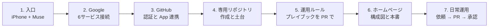

# セットアップの流れ

iPhone だけで、現在の仕組み（ハイブリッド型の AI駆動開発環境）をゼロから構築した手順です。
実施済みの手順をそのまま記録しています。再現や復旧の際はこの順番で進めます。

## 全体像

## 1. 入口を用意する

- iPhone に Muse アプリを入れ、ログインする（ログインと二段階認証は本人が行う）
- 以後の操作はすべて iPhone のチャットから行う。PC は不要

## 2. Google サービスを接続する

対象は Gmail、Google Drive、Google Sheets、Google Docs、Google Slides、Google Calendar の6つ。

1. Muse に接続を依頼し、各サービスの接続リンクを受け取る
2. リンク先で **すべて同じ Google アカウント** を選んで許可する（アカウントがバラけると横断利用ができない）
3. Muse 側で6つすべての接続状態を再確認する

## 3. GitHub を接続する

1. Muse に接続を依頼し、接続リンクから GitHub の OAuth 認証を行う
2. 続いて Muse の GitHub App のインストール画面を開く
3. アカウントを選び、Muse がアクセスできるリポジトリの範囲を設定する

注意: 認証だけではリポジトリは見えない。App の対象に入っていないプライベートリポジトリは「存在しない」ものとして扱われる。

## 4. 専用リポジトリを作り、土台を入れる

1. リポジトリの作成は **GitHub 上で本人が行う**（Muse の連携にはリポジトリ作成の権限がなく、API は 403 になることを確認済み）
   - 名前: `ai-dev-workspace`、Private で作成
2. 作成したリポジトリを GitHub App の対象に追加する（手順3の画面で選択して保存）
3. Muse 側で検索と読み取りができることを確認する
4. Muse が最初の土台を1コミットで投入する
   - `README.md`（目的・進め方・ルール）
   - `AGENTS.md`（AIエージェントの作業規約）
   - `.gitignore`（秘密情報や依存物の除外）
   - `docs/README.md` と `docs/spec-template.md`（仕様の置き場と雛形）

## 5. 運用ルールを PR で入れる

1. `main` からブランチを切る（例: `docs/playbook`）
2. `docs/playbook.md`（昇格基準・チェックリスト・開発サイクル）を追加する
3. プルリクエストを作成し、内容を確認して本人がマージを承認する
4. Muse がマージを実行する

これがこのリポジトリの最初の PR 運用の1周になります。

## 6. ホームページと構成図を置く

- リポジトリのトップ（README）に構成図の概要とリンクを置く。これが GitHub 上の顔になる
- `docs/architecture.md` に全体図と状態表、`docs/setup.md`（本書）に手順を置く
- `docs/index.html` は GitHub Pages 用のホームページソース
  - 公開する場合: リポジトリの Settings → Pages で、公開元を `main` ブランチの `/docs` に設定する
  - 注意: プライベートリポジトリの Pages 公開は GitHub の有料プランが必要な場合がある。その場合は README と docs の閲覧がホームページの役割を果たす

## 7. 日常運用の始め方

- 作りたいものを iPhone で伝える → 仕様が `docs/` に起きる → 承認 → ブランチで実装 → PR → 承認 → マージ
- 試作で済むものは Muse スペースで作り、プレイブックの昇格基準に当てはまったらこのリポジトリへ移す

## トラブル対処

| 症状 | 原因と対処 |
|---|---|
| 作ったリポジトリが Muse から見えない | GitHub App の対象に未追加。インストール設定で対象に追加して保存する |
| リポジトリ作成が 403 になる | Muse の連携に作成権限はない。GitHub 上で本人が作成する |
| リポジトリが空と言われる | 作成時に README 初期化をしなかったため。最初の土台投入で解消する |
| Google の横断利用ができない | サービスごとに違うアカウントを接続した可能性。全サービスで同じアカウントにする |
